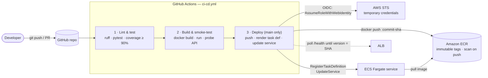
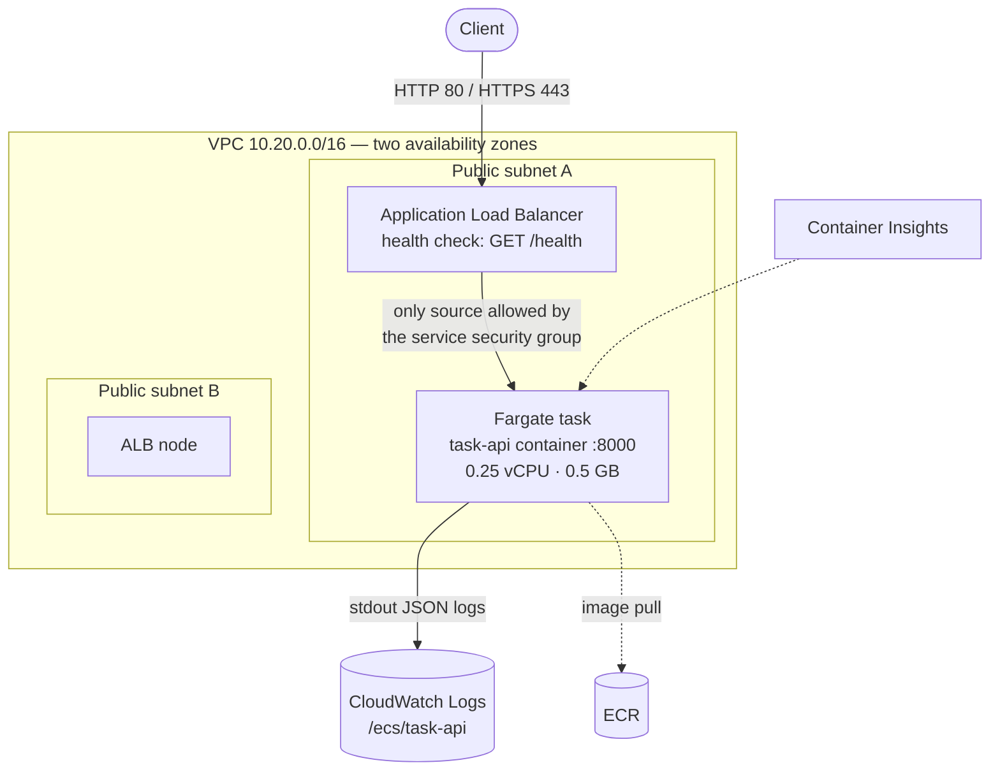

# Architecture

## 1. Delivery pipeline

| Trigger | Lint & test | Build & smoke-test | Push & deploy |
|---|:-:|:-:|:-:|
| Pull request to `main` | ✅ | ✅ | — |
| Push / merge to `main` | ✅ | ✅ | ✅ (once AWS variables are set) |
| Manual (`workflow_dispatch`) on `main` | ✅ | ✅ | ✅ |

Each job only starts if the previous one passed, so a failing test can never reach AWS.

## 2. Runtime on AWS

## 3. Components

| Layer | Component | Why |
|---|---|---|
| App | FastAPI + Pydantic | Validation is declared in the models, and the OpenAPI docs are generated from the same code. |
| App | Repository interface (`TaskRepository`) | Routes don't know how data is stored; the in-memory store can be swapped for DynamoDB/RDS by adding one class. |
| App | Request-ID middleware + JSON logs | Every response has an `X-Request-ID` that also appears in the CloudWatch log line, so a client-reported error can be found in seconds. |
| Container | Multi-stage Dockerfile, non-root, `HEALTHCHECK` | Smaller image, smaller attack surface, self-reported health. |
| CI | GitHub Actions | Lives next to the code; free for public repos. |
| Registry | Amazon ECR | Private, in the same account and region as ECS (fast pulls, IAM-controlled), with vulnerability scanning. |
| Compute | ECS on Fargate | Runs containers without managing servers (see §4). |
| Network | ALB + 2 public subnets | Stable public DNS name, health-checked routing, zero-downtime deploys. |
| IaC | CloudFormation (two stacks) | The whole environment is reproducible from the repo and deletable with one command. |
| Auth | GitHub OIDC → IAM role | No long-lived AWS keys exist anywhere (see §5). |

## 4. Why ECS Fargate

| Option | Verdict for this project |
|---|---|
| **ECS on Fargate** ✅ | Runs the same Docker image built in CI; no servers to patch; native rolling deploys with automatic rollback; first-class support in the official AWS GitHub Actions; scales to many services later. It is AWS's standard platform for containerised web services and maps directly onto the assignment's "Docker → registry → deploy" flow. |
| App Runner | Simplest option, but less control over networking and deployment behaviour, and less transferable to how most teams run containers on AWS. |
| EC2 + Docker | You'd own OS patching, scaling and the deploy mechanism (SSH or CodeDeploy). More work, less reliable. |
| EKS (Kubernetes) | Powerful but the control plane alone costs ~USD 73/month and adds a lot of operational surface for one small API. |
| Lambda | Possible with an adapter, but it isn't the "container that runs a server" model the assignment describes, and cold starts affect latency. |

## 5. Security decisions

- **No stored cloud credentials.** GitHub Actions requests an OIDC token; AWS STS swaps it for credentials that last at most one hour. Nothing to leak, nothing to rotate.
- **Narrow trust.** The deploy role trusts only `repo:<org>/<repo>:environment:production`. A fork, another branch's job outside that environment, or another repository can't assume it.
- **Least privilege.** The role can push to one ECR repository, update one ECS service, and pass only the app's two ECS roles, and only to `ecs-tasks.amazonaws.com`.
- **Two separate runtime roles.** The *execution role* lets ECS pull the image and write logs; the *task role* (what the app code gets) has no permissions because the app calls no AWS APIs.
- **Network isolation.** Containers have public IPs only for outbound image pulls; their security group accepts inbound traffic **only from the load balancer's security group**.
- **Hardened container.** Non-root user (UID 10001), read-only root filesystem on ECS, no build tools in the final image, `.dockerignore` keeps `.env` files and git history out.
- **Supply chain.** Immutable image tags, scan on push, dependency versions pinned, action major versions pinned.
- **Safe errors.** Unhandled exceptions are logged in full but the client only receives a generic message plus the request ID.
- **Optional TLS.** Pass an ACM certificate ARN and the ALB serves HTTPS (TLS 1.2/1.3 policy) and redirects HTTP to it.

## 6. Deployment strategy

ECS **rolling update** with `minimumHealthyPercent: 100` and `maximumPercent: 200`:

1. A new task starts alongside the old one.
2. It must pass the container health check **and** two consecutive ALB health checks on `/health`.
3. The ALB moves traffic to it; the old task drains for 30 s and stops.

If the new task never becomes healthy, the **deployment circuit breaker** rolls the service back to the last working revision, and the pipeline's "wait for service stability" step fails, so the failure is visible in GitHub. Users keep being served by the old version throughout.

**Build once, deploy that artifact:** the deploy job loads the exact image tarball that passed the smoke test; it never rebuilds. The commit SHA is both the image tag and the `version` field in `/health`, so you can always tell which commit is live.

## 7. Trade-offs made deliberately for an assignment

| Choice | Saves | Production alternative |
|---|---|---|
| Public subnets, no NAT gateway | ~USD 32/month | Private subnets + NAT gateway, or VPC endpoints for ECR/S3/Logs |
| One task, in-memory storage | A database | DynamoDB table (pay-per-request) + 2+ tasks across AZs + auto scaling |
| HTTP by default | Needing a domain | Route 53 domain + ACM certificate (already supported via `CertificateArn`) |
| Single `production` environment | A second stack | `staging` stack deployed on every merge, `production` on tag or manual approval |

## Next steps for production

1. **Persistent storage:** implement `DynamoDBTaskRepository` (the interface is already there), grant the task role `dynamodb:*Item`/`Query` on one table, raise `DesiredCount` to 2.
2. **Auto scaling:** target-tracking on CPU (e.g. 60%) between 2 and 6 tasks.
3. **Staging environment** with its own stack and an approval gate before production.
4. **Authentication:** API keys or JWT (Cognito) on the task endpoints.
5. **Alarms:** CloudWatch alarms on ALB 5xx count and unhealthy host count, sent to SNS/email.
6. **Image scanning gate in CI** (e.g. Trivy) that fails the build on critical CVEs before the push.
